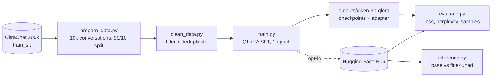

# Qwen2.5-3B QLoRA fine-tuning on UltraChat

<p>
  
  
  
  
</p>


**Fine-tune a 3B chat model on two free Kaggle T4s: a LoRA adapter for Qwen2.5-3B-Instruct, trained in 4-bit on cleaned UltraChat conversations.**

This repository is the full pipeline, from raw data to a published adapter. It takes 10,000 conversations from
[UltraChat 200k](https://huggingface.co/datasets/HuggingFaceH4/ultrachat_200k) and drops the malformed ones. It then
trains a QLoRA adapter on top of [Qwen/Qwen2.5-3B-Instruct](https://huggingface.co/Qwen/Qwen2.5-3B-Instruct) with
TRL's `SFTTrainer`. Last, it scores the result on a held-out split and compares answers with the base model.

**Trained adapter:** [llm-lab-dz/qwen-3b-qlora-ultrachat](https://huggingface.co/llm-lab-dz/qwen-3b-qlora-ultrachat) on the Hugging Face Hub (public, with its checkpoints).

## Highlights

- **Fits in 2 × 16 GB.** The base model is loaded in 4-bit NF4 with double quantization. LoRA trains on every attention and
  MLP projection, with gradient checkpointing and paged 8-bit AdamW. T4s have no bf16, so training runs in fp16 with
  gradient clipping turned off.
- **Survives session limits.** A checkpoint is saved every 100 steps, and `train.py` resumes from the latest one on its
  own. With Hub uploads enabled, it pushes every *N* saves, and pushes the latest checkpoint if training crashes.
- **Uploads are opt-in.** Nothing leaves the machine unless `ENABLE_HUB_PUSH=true` and `HF_REPO_ID` are set, and new
  Hub repos are private by default.
- **Data is checked before training.** Conversations with the wrong role order, empty turns, extreme lengths, or exact
  duplicates are removed first (rules below).

## How it works



### Training configuration (`src/train.py`)

| Setting | Value |
|---|---|
| Base model | `Qwen/Qwen2.5-3B-Instruct` |
| Quantization | 4-bit NF4, double quantization, fp16 compute (bitsandbytes) |
| LoRA | r = 16, alpha = 32, dropout = 0.05, no bias, on `q/k/v/o_proj` and `gate/up/down_proj` |
| Sequence length | 1,024 tokens, no packing; each conversation is rendered with the Qwen chat template |
| Batch | 1 per GPU × 4 gradient-accumulation steps (8 per optimizer step on 2 GPUs) |
| Optimizer | `paged_adamw_8bit`, learning rate 2e-4, cosine schedule, 50 warmup steps |
| Precision and memory | fp16 mixed precision, `max_grad_norm = 0`, gradient checkpointing (non-reentrant) |
| Schedule | 1 epoch, evaluation every 250 steps, checkpoint every 100 steps (keep 3), seed 42 |

### Data cleaning rules (`scripts/clean_data.py`)

A conversation is kept only if:

- it has at least 2 messages, using only the `user` and `assistant` roles;
- the roles strictly alternate, starting with `user` and ending with `assistant`;
- every message has at least 3 characters after trimming;
- the whole conversation has between 20 and 12,000 characters.

Messages are then trimmed, and exact duplicate conversations are removed. Train and validation are cleaned separately.

## Results

Numbers from `checkpoint-1091/trainer_state.json`, published with the adapter. They come from one run on Kaggle (2 GPUs),
1 epoch, 1,091 optimizer steps. Validation is the cleaned held-out split from `prepare_data.py`.

| Step | Epoch | Validation loss | Perplexity | Mean token accuracy |
|---:|---:|---:|---:|---:|
| 250 | 0.23 | 1.210 | 3.355 | 68.16% |
| 500 | 0.46 | 1.205 | 3.335 | 68.25% |
| 750 | 0.69 | 1.201 | 3.323 | 68.35% |
| 1000 | 0.92 | **1.199** | **3.317** | **68.37%** |

- Training loss falls from 1.56 (step 10) to about 1.20 by step 50, then stays near 1.2 for the rest of the epoch.
  Validation loss improves by only 0.011 between steps 250 and 1000.
- A small change is expected here: the base model is already chat-tuned, and UltraChat is general-purpose chat.
- **No base-model score exists on the same split.** `evaluate.py` scores the adapter only, so these numbers do not
  measure an improvement over Qwen2.5-3B-Instruct itself. `inference.py` gives a side-by-side comparison, not a metric.

## Repository layout

```
scripts/prepare_data.py   download UltraChat train_sft, keep 10,000 conversations, 90/10 split -> data/processed/{train,validation}
scripts/clean_data.py     filter + deduplicate -> data/processed/{train_clean,validation_clean}
src/train.py              QLoRA SFT; checkpoints and final adapter in outputs/qwen-3b-qlora/
src/evaluate.py           validation loss, perplexity, mean token accuracy, and sample generations for an adapter
src/inference.py          base vs fine-tuned answers on three fixed prompts
scripts/test_gpu.py       check that PyTorch sees a CUDA GPU
scripts/test_model.py     smoke test: generate one answer with Qwen2.5-1.5B-Instruct
requirements-kaggle.txt   library versions the published adapter was trained with (they match its model card)
requirements.txt          full pinned local environment (PyTorch 2.11, CUDA 12.8 wheels)
.env.example              Hub upload settings
docs/PROJECT_GUIDE.md     longer walkthrough of the pipeline
```

## Getting started

Training needs a CUDA GPU (`train.py` stops without one). `evaluate.py` and `inference.py` also run on CPU, slowly.

```bash
# 1. environment
python -m venv .venv && source .venv/bin/activate     # Windows: .venv\Scripts\activate
pip install -r requirements-kaggle.txt                # what the published adapter used
# or the full local pin set:
# pip install -r requirements.txt --extra-index-url https://download.pytorch.org/whl/cu128

python scripts/test_gpu.py

# 2. data (written to data/processed/, which git ignores)
python scripts/prepare_data.py
python scripts/clean_data.py

# 3. training (run again with the same command to resume from the latest checkpoint)
python src/train.py                                   # one GPU
torchrun --nproc_per_node=2 src/train.py              # two GPUs, e.g. Kaggle 2 x T4
```

On Kaggle, clone the repository into `/kaggle/working` so that `data/` and `outputs/` stay writable.

### Optional: push checkpoints to the Hugging Face Hub

The scripts read these settings from **environment variables**. `.env.example` lists them, but nothing loads a `.env`
file automatically, so export them in the shell first.

```bash
hf auth login                                   # or set HF_TOKEN
export ENABLE_HUB_PUSH=true
export HF_REPO_ID=your-org/qwen-3b-qlora-ultrachat
export HF_PRIVATE_REPO=true                     # default: true
export PUSH_TO_HUB_EVERY_N_SAVES=5              # default: 5, i.e. one push every 500 steps
```

### Evaluate and compare

```bash
# needs data/processed/validation_clean from step 2
export HF_REPO_ID=llm-lab-dz/qwen-3b-qlora-ultrachat   # or a local folder such as outputs/qwen-3b-qlora
python src/evaluate.py      # loss, perplexity, token accuracy + 3 sample answers next to the dataset's reference

python src/inference.py     # base vs fine-tuned on 3 fixed prompts (adapter set by ADAPTER_REPO in the file)
```

`evaluate.py` also reads `BASE_MODEL_NAME`, `VALIDATION_PATH`, `MAX_SEQ_LENGTH`, `NUM_SAMPLE_GENERATIONS`,
`MAX_NEW_TOKENS` and `SEED` from the environment.

## Limitations

- **The loss covers the whole transcript.** Conversations are trained as plain chat-template text, so user turns are
  in the loss too. There is no assistant-only masking.
- **Long conversations are truncated.** Cleaning keeps conversations up to 12,000 characters, but training cuts every
  sequence at 1,024 tokens.
- **The sample is not random.** `prepare_data.py` keeps the *first* 10,000 rows of `train_sft` and shuffles only after
  selecting them.
- **One epoch, no tuning.** The hyperparameters were not searched, and there is no base-model baseline (see Results).
- **Comparisons are sampled.** Generation uses temperature 0.7, so the answers from `inference.py` and `evaluate.py`
  change from run to run.

## Credits

Built by [AbderrahmaneTB](https://github.com/AbderrahmaneTB) and [WaelYTz](https://github.com/WaelYTz) at
[llm-lab-dz](https://github.com/llm-lab-dz).

Thanks to the Qwen team for Qwen2.5-3B-Instruct; to Hugging Face H4 for UltraChat 200k, filtered from UltraChat
(Ding et al., 2023); and to the Transformers, PEFT, TRL, Datasets and bitsandbytes maintainers.

## License

Code: [MIT](LICENSE). Qwen2.5-3B-Instruct is released under the
[Qwen Research License](https://huggingface.co/Qwen/Qwen2.5-3B-Instruct/blob/main/LICENSE). The adapter is used on top
of that model, so those terms apply to it as well. UltraChat 200k is MIT-licensed.
